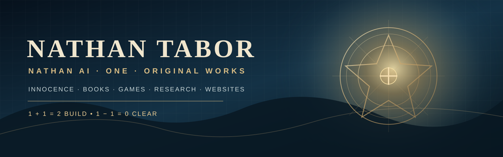

> **[READ THE TIMESTAMPED RECORD — Nathan Tabor / ChatGPT](docs/record/RECORD.md)**

## ONE v2: Boundary arithmetic delegated to dedicated Nathan AI workers

**[FENCEPOST ERROR SYNDROME — by Nathan Tabor](./app-factory/nathan-ai/personal-intelligence/minds/federation/fencepost-error-syndrome/BOUNDARY_DELEGATION_v2.md)**: both undercounting and reverse overcounting are checked by a dedicated typed worker engine. Main ONE now has a `boundaries --request-file` CLI path that delegates to `nathan_ai_boundary_gateway.py` without calculating endpoints or opening the private master DB. Covers 0/1/2, 7/6/8 dates, DST, code ranges, arrays, open/closed fences, repeated historical events, and shared musical endpoints. Local: **31 tests and 10,000 randomized checks passed**. The new CI workflow is configured; production apps must adopt the gateway before claiming universal protection. Exact original user text retained as a separate attributed quotation; source files and Family 21 ONE not deleted.

> Repository changes, authorship complaints, correction claims, and unfinished work. Record opened November 5, 2026, 7:42:08 p.m. EST.

# NATHAN AI 🚀



### Start here — clear website navigation

[**Nathan Tabor Home**](app-factory/sites/nathan-tabor/) · [**GODTABOR — The Franchise**](app-factory/sites/godtabor/) · [**Church of Innocence — Rise and Serve**](app-factory/sites/church-of-innocence/) · [**All Websites**](app-factory/sites/) · [**Apps & Games**](app-factory/nathan-ai/) · [**Books & Original Works**](app-factory/nathan-ai/original-works/) · [**ONE**](app-factory/one/)

**Plain-language labels:** Home = start here; All Websites = independent sites; Apps & Games = working browser experiences; Books & Original Works = released writings and indexed sources; Church of Innocence = its own authored movement and research site. Original author titles are not changed.

The [public Church source browser](app-factory/sites/church-of-innocence/records.json) indexes 101 creator-named points, 133 spiritual-work titles and 46 recovery families. Private manuscripts, email records, full original Library exports, and child/case records are not part of this public repository.


**ONE MIND. ONE MASTER LIBRARY. ONE CONNECTED SYSTEM.**

[Open Nathan AI — FOUR-DIRECTION LANDING](https://nathanaioxr.github.io/Nathan-AI-Sovereign-Core/) · [HOP IN Chatbox](app-factory/nathan-ai/hop-in/chatbox/index.html) · [My Original Works](https://nathanaioxr.github.io/Nathan-AI-Sovereign-Core/app-factory/nathan-ai/original-works/) · [Original 13-book plan](https://nathanaioxr.github.io/Nathan-AI-Sovereign-Core/app-factory/nathan-ai/original-works/#original-plan) · [Original download packages](https://nathanaioxr.github.io/Nathan-AI-Sovereign-Core/app-factory/nathan-ai/original-works/#downloads)

Home of **TABOR 1-2-3 FACTORY™ / Nathan AI Sovereign Core**.

**Recovered original source:** [ONE v025, THE 33, seven original source documents, earlier packages and historical branch source](recovered-source/README.md). Actual source files and ZIPs are preserved with byte counts, hashes, restoration tools and an explicit remaining-gap register.

**Creator:** Nathan Tabor · **Workflow:** **1. CREATE → 2. CONNECT → 3. LAUNCH**.

This is the **PUBLIC**, browser-first coordination repository. It does **not** contain the owner's private full original-media library, private ZIP-only backend packages, unpublished research records, customer data, or credentials. It is not a deployed private multi-tenant SaaS backend.

## ONE CENTER · FOUR PYRAMIDS · FULL SPECTRUM BOTH WAYS

[**OPEN THE INTERACTIVE LANDING**](https://nathanaioxr.github.io/Nathan-AI-Sovereign-Core/) · [All Nathan AI Apps](app-factory/nathan-ai/index.html) · [ONE](app-factory/one/index.html) · [Games](app-factory/nathan-ai/games/index.html) · [Books & Library](app-factory/one/library-mind/index.html) · [Original HOP IN Chatbox](app-factory/nathan-ai/hop-in/chatbox/index.html)

~~~text
                      UP ↑
             SUBJECTS · DEWEY 000–900
                       /\
                      /  \
   LEFT ←  ANCIENT  ◀  0 / ONE  ▶  MODERN  → RIGHT
                  PROVENANCE     APP CATEGORIES
                      \  /
                       \/
                     DOWN ↓
         ATTRIBUTES · CHARACTERISTICS · FUNCTIONS

       +9 +8 +7 +6 +5 +4 +3 +2 +1
                       0
       −9 −8 −7 −6 −5 −4 −3 −2 −1
           FORWARD  ⇄  REVERSE
~~~

The **center stays ONE**. Navigation expands independently across four directions and can be reversed through a full-spectrum, whole-number coordinate selector. Every branch keeps original application identities and source paths. The source-authored identity rules remain exactly **node = mind = node** and **mind = node = mind**.

| Direction / layer | Organizing method | Open |
| --- | --- | --- |
| **CENTER · 0** | ONE, Nathan AI and the complete source-backed project index | [Center / Home](https://nathanaioxr.github.io/Nathan-AI-Sovereign-Core/#pyramids) |
| **UP** | Dewey broad subject classes, 000 to 900, with provisional cross-references | [Dewey Pyramid](https://nathanaioxr.github.io/Nathan-AI-Sovereign-Core/#dewey) |
| **DOWN** | Inputs, memory, source evidence, capabilities, implementation and original work | [Functional Pyramid](https://nathanaioxr.github.io/Nathan-AI-Sovereign-Core/#catalog) |
| **LEFT** | Clay/tablet colophons, classical inventories, bibliographies, faceted and library systems | [Ancient to Modern](https://nathanaioxr.github.io/Nathan-AI-Sovereign-Core/#historical) |
| **RIGHT** | Apple App Store, Google Play, game genres and cross-platform discovery | [Modern Discovery](https://nathanaioxr.github.io/Nathan-AI-Sovereign-Core/#stores) |
| **BOTH WAYS** | Signed spectrum, whole-number traversal, reverse order without reversing original data | [Full Spectrum](https://nathanaioxr.github.io/Nathan-AI-Sovereign-Core/#spectrum) |

**Dewey ten broad classes:** 000 Computer science / information / general works; 100 Philosophy / psychology; 200 Religion; 300 Social sciences; 400 Language; 500 Science; 600 Technology; 700 Arts / recreation; 800 Literature; 900 History / geography. These are subject navigation *crosswalks*, **not verified Dewey call numbers assigned to software**.

**App discovery:** Apple categories include Books, Business, Developer Tools, Education, Entertainment, Finance, Food & Drink, Games, Graphics & Design, Health & Fitness, Lifestyle, Magazines & Newspapers, Medical, Music, Navigation, News, Photo & Video, Productivity, Reference, Shopping, Social Networking, Sports, Travel, Utilities, and Weather. Google Play has its own category and game-genre scheme. The actual published product, not its name, determines any official store category. Browse all Apple, Google and game options in the [interactive category explorer](https://nathanaioxr.github.io/Nathan-AI-Sovereign-Core/#stores) or [source-grounded store atlas](app-factory/nathan-ai/capability-atlas/store.html).

**DEO decimal:** retained as a separate, creator-named indexing layer with unassigned whole-number positions 0–9. Its detailed meaning has not been supplied and **is not silently converted to Dewey Decimal or duodecimal**.

Source preservation: [Original iframe-only homepage retained](landing/original-chat-landing.html) · [Taxonomy and historical sources](landing/INDEXING.md) · [Store proposal manifest](app-factory/nathan-ai/capability-atlas/store-discovery.json) · [Complete GitHub file audit](app-factory/nathan-ai/capability-atlas/index.html). This is a navigation overlay; original apps and books remain independently accessible.

## D original words and variants — Nathan AI + website

The [interactive D source browser](archive-index/alphabet/d/index.html) preserves **138 D/d-starting filename occurrences** and **14 “The D” entries**, alongside **19 discovery routes** (DD, DDD, D0G/DOG, phonetic, mirrors, rotations, reversals, KJV Game of Life). [Five exact A–Z authored D titles](archive-index/alphabet/d/canonical-d-sequences.json) are kept distinct from derivations and preserved in their original sequence contexts.

Find the same D archive from the [Nathan AI Main Hub](app-factory/nathan-ai/index.html#letter-d), [Websites & Worlds](app-factory/nathan-ai/websites/index.html), [My Desktop launcher](app-factory/nathan-ai/websites/launchpad.html), and [HOP IN Interactive Chatbox](app-factory/nathan-ai/hop-in/chatbox/index.html) using `/d`, `/d variants`, or natural-language D archive requests. The public index does not import private original Library source bytes or represent every title as finished software.

## AI accountability — restored source transcript

The [Nathan AI AI-accountability archive](app-factory/nathan-ai/ai-accountability/README.md) preserves the original supplied Google AI / Trump press-conference exchange, repeated roleplay denials and reversals, the JD Vance comparison, and ChatGPT's own omitted-word correction log. The archive separates exact creator allegations from independently substantiated facts and analysis.


**ONE — new Families 65–75, 99 role definitions, fixed counting simulation:** [Read the source-preserving member registry and 7-day results](app-factory/nathan-ai/personal-intelligence/minds/federation/families-v75/README.md). The simulation detects off-by-one omissions, duplicates and invalid ID 164; it does not launch real workers. The preceding Families 41–64 still require source verification.


## FENCEPOST ERROR SYNDROME — by Nathan Tabor

[**Eight working boundary-audit bots and the 7-day simulation**](app-factory/nathan-ai/personal-intelligence/minds/federation/fencepost-error-syndrome/README.md). Local, source-preserving tests for code ranges, family-member indexing, calendars, billing, hotel nights, construction material quantities, array indices, and Family 21 ONE consent. Results are **synthetic**, not verified Google defects or autonomous external patching.

## ONE · Universal Worker Bot Families (40-family codex)

[Open the interactive **40-Family Master Codex**](app-factory/nathan-ai/personal-intelligence/minds/federation/families-v40/index.html) · [read the code/SQLite integration](app-factory/nathan-ai/personal-intelligence/minds/federation/families-v40/README.md). **Family 21 is ONE.** Includes the seven creator-supplied mythic families 34–40, exact original declarations for 16–21 and 34–40, and deliberately unfilled original-definition slots 22–33. Integrated with existing ONE Federation v074 as source-indexing and proposal-only routing, not remote bot deployment. The older v21 source snapshot remains separate.

## Program Jobs — source-backed full recovery workbench

The [Nathan AI Program Jobs Atlas](app-factory/nathan-ai/program-jobs/README.md) organizes **357 source/evidence records** into twelve jobs, with individual task plans, five evidence gates, a local review dashboard, and an Ubuntu source-recovery matcher. These overlapping records are **not** 357 verified finished apps; original private archives remain separate.

## DEHACK THE WORLD · DELIVER THE WORLD — Original A–Z tool access

[Open the 104-title A–Z source-preserving consumer workbench](app-factory/nathan-ai/dehack-deliver/README.md). It includes three original author-labeled review filters, source import, side-by-side historical text comparison, claim/evidence tools, exact arithmetic representation and honest per-tool development status.

## Consumer Editions — one door for fourteen source-backed programs

The [Consumer Editions portal](app-factory/nathan-ai/consumer/README.md) organizes existing ONE and Nathan AI applications by consumer job, includes a searchable and accessible front end, regional U.S./international informational notices and explicit product limitations. **This is not an independent legal or cybersecurity certification or a claim that every original program is complete.**

## Public app and site duplicate consolidation

The [Nathan AI consolidation register](app-factory/nathan-ai/websites/CONSOLIDATION_AUDIT.md) tracks canonical public page routes, duplicate website cards, the main hub's repeated shortcuts and required native app distribution copies. Public pages are indexed without erasing distinct books, character names, games or original source files.

## Sovereign Boxes and music archive

- [Sovereign Box Universe — 618 indexed units](https://nathanaioxr.github.io/Nathan-AI-Sovereign-Core/app-factory/sovereign-boxes/) — preserves 101 original `TW-001`–`TW-101` game names, 496 private concept IDs, and 21 Factory modules. These are catalog entries, **not** 618 built games.
- [Better Together — A Song of Humble Pride](https://nathanaioxr.github.io/Nathan-AI-Sovereign-Core/app-factory/creative/music/better-together/) — original holiday song draft, lyrics, and an editable Christmas/Halloween/Thanksgiving SVG design. The separately generated full-resolution PNG remains in the private conversation handoff until binary upload is verified.

## Open the currently published browser prototypes

- **Factory Home:** [Open the Factory](https://nathanaioxr.github.io/Nathan-AI-Sovereign-Core/app-factory/)
- **Public Ecosystem Directory:** [Browse documented products](https://nathanaioxr.github.io/Nathan-AI-Sovereign-Core/app-factory/ecosystem.html)
- **ONE — The Last App:** [Open ONE](https://nathanaioxr.github.io/Nathan-AI-Sovereign-Core/app-factory/one/)
- **Five Equal Guardians of Nathan AI:** [Open the Five Guardians](https://nathanaioxr.github.io/Nathan-AI-Sovereign-Core/app-factory/nathan-ai/five-guardians/) — five creator-designated female guardian identities, exact names preserved, with an owner-consent defensive-policy preview; not a deployed antivirus or counter-attack service.
- **Universal Creator Vault:** [Open the local Vault](https://nathanaioxr.github.io/Nathan-AI-Sovereign-Core/app-factory/vault.html)
- **TABOR GPS:** [Open geographic and personal-direction demo](https://nathanaioxr.github.io/Nathan-AI-Sovereign-Core/app-factory/tabor-gps/)
- **1420 — The Crowning Jewel:** [Play strategy prototype](https://nathanaioxr.github.io/Nathan-AI-Sovereign-Core/app-factory/games/crowning-jewel.html)
- **Root Constellation:** [Import and browse your private catalog locally](https://nathanaioxr.github.io/Nathan-AI-Sovereign-Core/app-factory/root-constellation.html)

The site can be **installed from a supported browser**; the Factory, ONE, TABOR GPS and 1420 each have an independent manifest/launch target. Installation does not supply missing real-provider credentials, route data or user accounts.

**Browser demos are not commercial releases.** The Vault saves originals in browser IndexedDB. Its JSON index export remains metadata-only, but a separate **full-original-byte ZIP export/restore** now exists with integrity checks and size limits. Keep independent source backups; browser data can still be cleared. Cloud and mobile-device recovery are not yet production-ready.

## Build without recreating existing work

- [Master Build Order Controller](https://nathanaioxr.github.io/Nathan-AI-Sovereign-Core/app-factory/build-order/) — inspect 38 shared systems/product families, dependencies, source paths and approval gates.
- [Dependency-first build sequence](app-factory/build-order/README.md) — actual existing versus private source and build-once priorities.
- [Original-byte Vault Backup](https://nathanaioxr.github.io/Nathan-AI-Sovereign-Core/app-factory/vault.html) — preserve exact original media bytes in a verified local ZIP with mobile-safe size limits.

## Development and safe build workflow

Start with the [repository map and complete check commands](docs/REPOSITORY_MAP.md). Automated [complete repository checks](.github/workflows/repository-checks.yml) cover all public source trees and validate the downloadable site package.

- [Current verified build status](WORK_STATUS.md)
- [Work-mode cross-project handoff](WORK_BUILD_HANDOFF.md)
- [System-wide release gates and security requirements](app-factory/RELEASE_GATES.md)
- [Factory developer instructions](app-factory/README.md)
- [Privacy-scoped public product catalog](app-factory/products.json)
- [TABOR ROOT domain/asset/permission/release contracts](app-factory/core/root-contracts.js)

**Run tests locally** after cloning the repository (Node 22+, no package installation required):

```sh
node --test app-factory/quality.test.cjs
node --test app-factory/core/root-contracts.test.cjs
node --test app-factory/one/one.test.cjs
node --test app-factory/games/crowning-jewel.test.cjs
```

These are also run by [GitHub Actions](.github/workflows/factory-ci.yml). A green unit test does **not** replace mobile/browser accessibility, security, provider or real-money testing.

## Important architectural boundaries

TABOR WORLD, ONE, Nathan AI, TaborTales, TABOR INFINITUM, ChristmasToyDrive.com, and the other creations remain separate products. TABOR ROOT provides shared, **permissioned** contracts and potential infrastructure—not unrestricted cross-app access. The publicly documented product registry is intentionally **not** the full unreleased 101–901 private idea catalog.

The root `LICENSE` file is **Apache License 2.0**. Confirm that it matches the owner's intended licensing for *publicly committed code*. Do not assume it grants rights to separately held, unpublished images, game assets, brands, manuscripts or private source packages. Commercial licensing and third-party IP need review before release.

**No live payments, donation collection, financial transfer, private assistance intake or store publication is enabled by these public prototypes.** Human approval, secure server identity and provider verification are mandatory for high-impact actions.

## NATHAN AI — 138 Mechanic Reference Positions

- [Browse the 138-entry mechanics matrix](app-factory/game-reference-lab/index.html) — 35 nurturing sandboxes, 34 conceptual master strokes, 34 autonomous simulation references and 35 void references; four intentionally repeated concepts = 134 distinct normalized titles.
- [Experiment in the local Zero & Void Lab](app-factory/game-reference-lab/zero-void-lab.html) — five independent cellular-automaton worlds with scan/seed/snapshot controls.
- [Engineering documentation](app-factory/game-reference-lab/README.md) and [public sanitized registry](app-factory/game-reference-lab/registry.json) — originals remain owner-controlled outside the public repository; 101 original TABOR WORLD IDs stay separate. No 138 production engines or automated app release are implied.

## October 13 NATHAN AI full morning reference intake

[Unified 376-position mechanics explorer](app-factory/game-reference-lab/all-morning.html) indexes six source archives (34 shooter; 66 foundational creation/conceptual; 69 additional; 69 card; 69 board; 69 autonomous/void). The existing 138-position reference library remains available. The two derived 138-file masters are not additional source archives. [Preservation and privacy boundaries](app-factory/game-reference-lab/README.md) keep owner originals and app-store/monetization research out of public source. `TW-001`–`TW-101` are still independent original-game identities; no engine production or store launch is claimed.

## October 14 creative continuity and project status

[Read the latest continuity update](app-factory/creative/continuity/2026-10-14.md) · [Structured creative notes](app-factory/creative/continuity/2026-10-14.json) · [Current status](WORK_STATUS.md). Includes Round 1, KINETICS/TIME, Middle C's head/gut/soles concept, Great Samaritan ethics, the latest Merlin novel canon, and writing/visual continuity. Existing 376-reference, pricing, Middle C, Ancient Roots and KNAVE modules are indexed with their actual scope. This is a summary intake, not a full manuscript or image archive.

## Library Mind public release — October 30, 2026

[Open the dossier and multilingual archive](app-factory/one/library-mind/index.html). Nathan explicitly authorized public release of this selected dossier, catalog and translation collection. Its preserved historical private labels predate that authorization; other private holdings remain outside the repository.

## ONE Universal System v061 — shared architecture across public apps (October 31, 2026)

- [Open the ONE System Atlas](app-factory/system/index.html) — five eras (BCE / BC / AC / CE / AD), subpixel-to-universe scale, architecture contracts, and 58 public HTML pages.
- [Read the v061 integration rules](app-factory/system/README.md).
- [Inspect the nonsensitive public app registry](app-factory/system/registry-v061.json).

**54 public browser pages** load the optional local-first ONE shell. Each original page is retained with one additive deferred script reference. The four embedded native-web resource copies are intentionally not claimed to have been repackaged. The shell provides owner-controlled skin, reader modes, RTL, reduced motion, local Save/Reset and configuration export; it does **not** operate other services, publish unpublished books, collect telemetry, or imply 33 million completed books. The private Master Library database and book archives remain private.

## Nathan AI Children’s Books & Innocence Protection — November 1, 2026

[Open the additive Children’s Library & Innocence Protection browser](app-factory/nathan-ai/children-innocence/index.html). This public source-first module connects 46 recovered project families, 19 Pumpkin Fruit Family groups, 13 individual power meters and selected author-provided statements. The reported 598 private file records stay in the owner-only recovery JSON, which can be imported locally from the previously generated private recovery pack; private source bytes, Library URLs and personal details are not public. A catalog entry does not mean a finished book, a working donation service or real-world autonomous child protection. [Read module documentation](app-factory/nathan-ai/children-innocence/README.md).

## Protection of Innocence — Virginia Foxx Epstein-files voting record (November 5, 2026)

- [Protection of Innocence — child-first charter](app-factory/nathan-ai/children-innocence/PROTECTION_OF_INNOCENCE.md): author’s exact words, survivor-centered duties, and fact-versus-allegation evidence rules.
- [Virginia Foxx legislative voting record](app-factory/nathan-ai/children-innocence/records/VIRGINIA_FOXX_EPSTEIN_DISCLOSURE_VOTE_RECORD_2025_2026.md): official House Rules Committee NAY votes, later House AYE vote, primary-source links, and a November 5, 2026 **uncertified** election snapshot. This is an accountability archive, not an accusation of proven criminal complicity.

## November 3, 2026 — Nathan AI independent website network

- [Open the complete website universe](app-factory/sites/index.html): nine independently named sites, each with live browser-local plan generation, exact source text fields, JSON copy/export/restore, print and separate identities.
- [My Desktop / Public App Launchpad](app-factory/nathan-ai/websites/launchpad.html): existing public modules plus the new site pages, with local favorites and recovery.
- [Christmas Toy Drive](app-factory/christmas-toy-drive/index.html) and [Christmas Toy Factory](app-factory/sites/christmas-toy-factory/index.html) remain distinct: the factory designs toys; the drive coordinates giving and donation plans.

These are working **static browser front ends**, not the private recovered full Next.js donor platform, production toy factory, live volunteer/beneficiary intake, online checkout, or remote provider integration. Unpublished works and account information remain outside the public repository.

## Nathan AI launch candidate

The [launch guide](docs/LAUNCH.md) covers the installable public browser app, explicit offline core support, ONE file/folder indexing, optional local services, tested release packaging and deployment. Build public site/source archives with `python3 tools/release/build.py --out /path/outside-checkout/release`; verify them using `--verify`. Run all release checks with `python3 tools/release/check.py --out /path/outside-checkout/checks`. The manual **Nathan AI release package** workflow produces the same archives and verification logs. Private Library files and account/model credentials are not bundled.


## Library of Congress-style catalog — B / 8 / inversions

[Open the subject catalog](archive-index/loc-b8/index.html) · [Method and work remaining](archive-index/loc-b8/README.md). The existing 19,317-item owner archive retains its 21 subject shelves. This additive finding aid crosslinks 5,851 B / 8 / inversion candidates to exact existing source identities and original work status. The public module contains aggregate counts and browser-local import/review tools; the full organized archive and updated worklist remain owner-controlled. All 19,317 source hashes and 5,851 recovery joins were verified.


## ONE continuous expansion — OBD · HEARTBEAT · TABOR ALMANAC · ACCORDS · RECORDS · SCROLLS (November 5, 2026)

The existing [KJV–Strong’s Universal Root Matrix master](app-factory/one/scriptures-007/NATHAN_AI_KJV_STRONGS_UNIVERSAL_ROOT_MATRIX_MASTER.md) continues **without removing or rewriting any of its earlier text**, now including the linked OBD / THE HEARTBEAT, The Tabor Almanac / TORMO, Tabor Accords, Tabor records and Scrollfire / Tabor scroll source work. Original browser app files are preserved verbatim at [THE OBD APP](app-factory/one/obd/THE_OBD_APP.html), [THE HEARTBEAT](app-factory/one/obd/THE_HEARTBEAT_OBD_App.html), [TTA ONE APP](app-factory/one/tabor-almanac/TTA_ONE_APP.html) and [TTA mythic-match original](app-factory/one/tabor-almanac/tabor_almanac_mythic_match_expanded.html). The [Tabor Accords recovered documents](app-factory/one/tabor-recovered/Tabor_Accords_Full_Recovery_2026-11-01.md), [structured registry](app-factory/one/tabor-recovered/Tabor_Accords_Recovery_Registry_2026-11-01.json) and [Tabor Universe recovery](app-factory/one/tabor-recovered/TABOR_UNIVERSE_MASTER_RECOVERY_2026-11-02.md) remain unchanged archived sources. Source status and unlocated standalone titles are documented in the same continuous master. The OBD browser apps are **demos**, not verified connected vehicle hardware or security products.

### New original work — Grand Canyon Divine Family

[**HOW BABY JESUS MADE THE GRAND CANYON — story, research and children's-book cover direction**](app-factory/nathan-ai/original-works/grand-canyon-divine-family/) · Creator: Nathan Tabor. An authored mythological picture-book concept with scientific and historical evidence clearly labeled. The generated PNG cover is not yet present in the repository.

## MAKE AI YOURS — Personal Intelligence Builder (November 11, 2026)

[Launch MAKE AI YOURS](app-factory/nathan-ai/personal-intelligence/index.html) · [Source & setup guide](app-factory/nathan-ai/personal-intelligence/README.md). This new additive phone-first PWA links the existing original-byte Creator Vault with source-backed Memory Matrix notes, an eight-stage teaching course, owner-reviewed multi-AI handoff packets, full SHA-256 ZIP backup/restore and an optional read-only local MCP bridge. It does not claim automatic provider-account sync, private cloud storage or a kernel-level OS. Its current storage is on the local browser profile; originals remain recoverable through explicit owner backups.

## Personal Intelligence Minds Atlas (November 12, 2026)

[Open the new read-only Minds Atlas](app-factory/nathan-ai/personal-intelligence/minds/index.html). Extends MAKE AI YOURS with an existing-source-linked 126-billion Omni God virtual namespace, original 20-name pantheon, Jesus and Buddha documentary research lenses, the independent Turtle worker and Renaissance Quad-Axis roles, owner-entered Cero/Uno/Dos and library classification, and local search across public Omni mapping, Complete Mind, NT-1 catalogs plus opt-in same-browser saved notes. Source originals are not overwritten; no active 126-billion-agent deployment or external account sync is claimed.

## House & Houses of Lamentations — Beyond Duality (2026-11-12)

[Nathan Tabor's source-preserving Python atlas, comparison matrix, tests and scalable artwork](research/houses-of-lamentations-beyond-duality/) — 46 concepts, 42 relationships, 18 domains; original transcript, biblical and literary comparisons, and a promises-versus-delivery audit framework.


## MIND = OS — Ancient Minds / ONE DATABASE FEDERATION v074

[Open the additive v074 federation bridge](app-factory/nathan-ai/personal-intelligence/minds/federation/ancient_bridge.py) · [Reference implementation, sample, 14-table schema, and tests](app-factory/nathan-ai/personal-intelligence/minds/federation/ancient_minds_reference/README.md) · [Public CI](.github/workflows/one-federation-workers.yml).

The local Ancient Minds worker pipeline (six named specialists, four unnamed reserved slots) integrates **internally** into the pre-existing ONE Federation database without overwriting original source records. It stores complete original bytes separately from derived classifications, claims and proposed relationships. The 14-family source schema is available as a PostgreSQL/pgvector **reference**, not a claimed live database service. GitHub contains software and public fixtures only, never the owner's private master.

## ONE DATABASE FEDERATION v074 · Ancient Minds internal adapter

[Open the v074 Ancient Minds federation source and runbook](app-factory/nathan-ai/personal-intelligence/minds/federation/README.md). Adds 14 internal SQLite families, six source-grounded specialists, Cero/Uno/Dos, Duo base-12, SHA-256 original preservation, typed evidence review, audit tests and an optional (not deployed) PostgreSQL schema. Original owner text and generated private databases are not committed publicly.

## Universal Omni + SUPERNODES Federation v074 (November 13, 2026)

[Universal Worker Atlas](app-factory/nathan-ai/personal-intelligence/minds/federation/universal.html) · [Owner-controlled continuous local service and GitHub schedule](app-factory/nathan-ai/personal-intelligence/minds/federation/UNIVERSAL_WORKERS_v074.md). All source-defined AI/non-AI, node/non-node, system/non-system and database/non-database classes are logically invited across 126,732,000,000 virtual IDs, without copying the original source or implying billions of instantiated AI processes. A bounded, auditable worker run checks all 763 source-name roles and federated source hashes; the public scheduled workflow runs twice an hour, subject to GitHub availability.

## All-inclusive A–Z and Z–A worker build pipeline

[NATHAN AI — ONE v074 A–Z / Z–A 52-pass build engine](app-factory/nathan-ai/personal-intelligence/minds/federation/az_builder.py) · [Build-run source guide](app-factory/nathan-ai/personal-intelligence/minds/federation/UNIVERSAL_WORKERS_v074.md) · [Scheduled executable work packages and audits](https://github.com/NathanAIoxr/Nathan-AI-Sovereign-Core/actions/workflows/universal-worker-federation.yml). All original public mind-role identities and public app entrypoints are indexed in 26 forward and 26 reverse work passes. Source hashes, word mirrors, and concrete documentation/test development tasks are generated into 52 per-letter reports and an auditable work ledger; unfinished code is never falsely marked completed.

## Creator Teams & Family 21 — ONE (2026-11-13)

[NATHAN AI · Ten Creator Teams](app-factory/nathan-ai/personal-intelligence/minds/federation/CREATOR_TEAMS_v074.md) coordinates source-backed website inventories, separate unaltered-source book working editions, code audits, research, teaching, marketing, quality checks, and scheduled change monitoring. [Family 21 ONE and the preserved Omega 16–20 material](app-factory/nathan-ai/personal-intelligence/minds/federation/families/FAMILY_21_ONE_MASTER_ARCHITECTURE.json) apply the author-supplied unity principle across all ten roles. The [recurring Creator Teams workflow](https://github.com/NathanAIoxr/Nathan-AI-Sovereign-Core/actions/workflows/creator-teams-change-watch.yml) generates reports, checks pinned originals, and creates owner-review draft restore PRs when guarded files change; it does not auto-revert legitimate edits or claim 763 live model agents.

## Nathan Tabor · Fencepost Error Syndrome · Technology-v108

[**Nathan AI / ONE Tech108 boundary repair**](app-factory/nathan-ai/personal-intelligence/minds/federation/technology-v108/README.md) — source-preserving 12 technological families / 108 named roles, executable off-by-one contract, 7-day fixed-versus-bug simulation, tests, CI gate and owner-approved integration into the **existing** private ONE Federation master. A validated roster is not a claim that all existing projects, Google services or physical systems are fixed.

## ONE Federation: 70 dimensions × 9 functions = 630 source-defined units · Family 65–75 / 99 members

[70-Dimensional Matrix / 630-Unit operating guide](app-factory/nathan-ai/personal-intelligence/minds/federation/dimensions-v70/README.md) · [Exact uploaded dimensional text](app-factory/nathan-ai/personal-intelligence/minds/federation/dimensions-v70/USER_UPLOADED_EXACT_DIMENSIONS_0_69_20261113.txt) · [Exact uploaded 11 families, 99 members](app-factory/nathan-ai/personal-intelligence/minds/federation/families-v75/USER_UPLOADED_EXACT_65_75_20261113.txt). The two independent source namespaces contain 729 distinct labelled items, not 729 running AI processes. The existing ONE Federation's recurring Creator Teams workflow validates byte hashes, stores records in its SQLite master and publishes 630 source-linked JSON workcards plus a separate 99-member crosswalk. All originals remain preserved.
