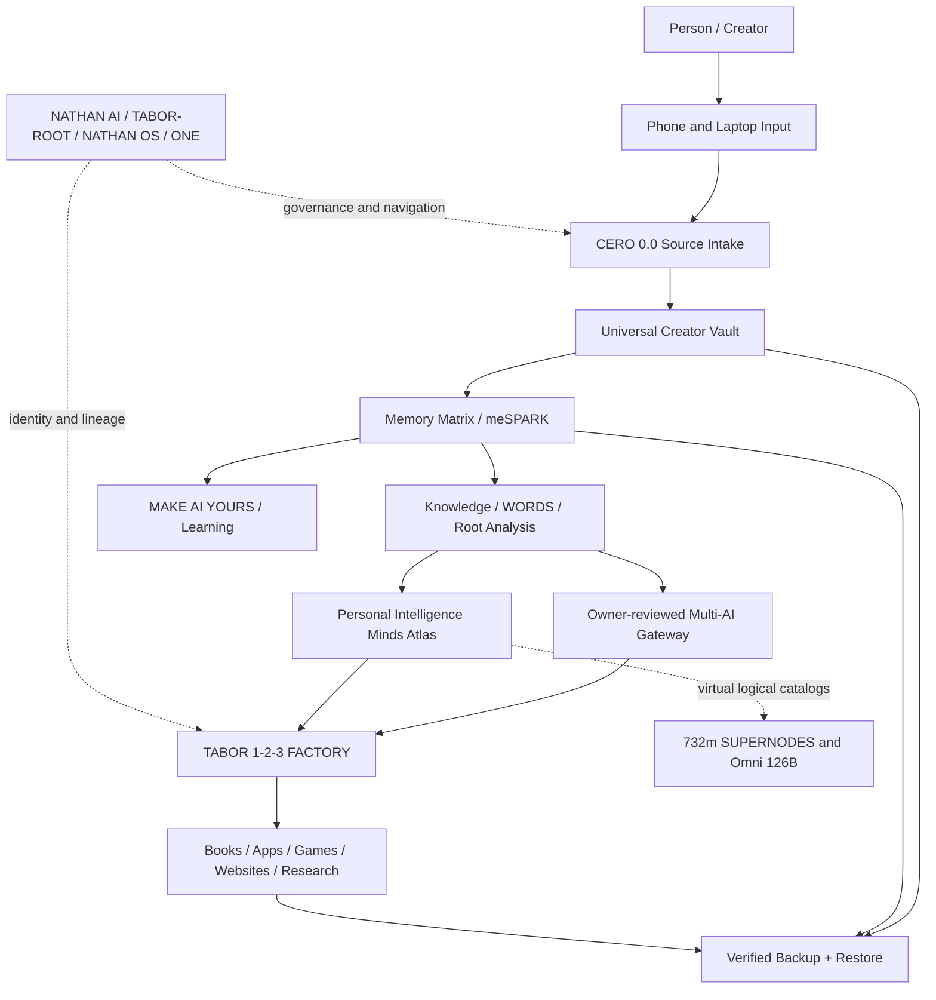

# THE NATHAN TABOR METHOD — COMPLETE SYSTEM MAP
**Creator:** John Nathan Tabor
**Product:** MAKE AI YOURS — powered by NATHAN AI
**Date:** 2026-11-12

> Architecture & evidence map. Preserve originals. This file is not a production-deployment certificate.

## Core architecture

**Physical meaning:** phone and laptop are interfaces; servers/models are computational services when explicitly connected. **Data meaning:** originals stay separate from derived interpretation.

## Ten operating principles mapped to implementation

| # | Principle | Software contract |
|---:|---|---|
| 1 | SOURCE FIRST | Store byte-identical originals; link corrections/interpretations without replacing them. |
| 2 | MEMORY AS STRUCTURE | Use entities, timestamps, relationships, source IDs, and cross-reference graph. |
| 3 | ROOT-LEVEL ANALYSIS | Run attributed phonetic/letter/root transformations as derived records. |
| 4 | DETERMINISTIC CONTROL | Treat BUILD/CLEAR operations as specified, tested procedures; 1+1 can build a tool that clears. |
| 5 | CONTINUOUS CREATION | Turn approved records into separately versioned books, apps, games, and research. |
| 6 | MULTI-AI COMPUTATION | Explicit, owner-reviewed handoffs; prohibit implied continuous sync. |
| 7 | ORIGINAL-IDENTITY PRESERVATION | Distinct namespaces, exact titles, historical versions, non-destructive linking. |
| 8 | MOBILE-FIRST OPERATION | Phone capture, laptop diagnostics and bulk operations. |
| 9 | VERIFIABLE RECOVERY | Hash every source, export off-device backups, restore in a separate profile/device. |
| 10 | TEACH THE METHOD | Onboarding, practical exercises, source ownership, transferable workflow. |

## Component registry

| Layer | Module | Status | Purpose |
|---|---|---|---|
| control | PERSON / CREATOR | principle | Owns original material, decides what is shared, authorizes transformations and releases. |
| capture | PHONE / VOICE PORTAL | interface | Mobile-first capture of voice transcription, images, notes, and commands. |
| capture | LAPTOP / DESKTOP | interface | Bulk file review, local source access, code testing, data migrations, backups and recovery checks. |
| preserve | CERO 0.0 / SOURCE INTAKE | merged code | Keep original bytes, text, language, timestamps and identity. Source is never overwritten by interpretations. |
| preserve | UNIVERSAL CREATOR VAULT | merged code | Stores original file and image bytes in local browser IndexedDB; exports full-byte ZIP backups. |
| recover | VAULT BACKUP / RECOVERY ENGINE | merged code | SHA-256 and ZIP integrity verification, owner-triggered export, non-destructive restore. Off-device backup and restore testing remain user responsibilities. |
| govern | TABOR-ROOT / SOURCE REGISTRY | architectural role | Canonical identity, source lineage, project/version identity, permissions, audit, policy, and operation provenance. |
| govern | NATHAN AI | repo-linked | Umbrella coordination, application navigation, agent/tool handoff and person-controlled orchestration. |
| govern | NATHAN OS | architectural role | Personal operating layer and terminal vision. Current implementation is user-level browser software, not a native OS kernel. |
| interface | ONE — THE LAST APP | repo-linked | Personal command center connecting notes, files, other applications and authorized tools without erasing their identities. |
| teach | MAKE AI YOURS | merged code | Installable phone-first PWA with eight teaching stages, source capture, typed notes, owner-reviewed AI handoffs and recovery exercises. |
| organize | MEMORY MATRIX / meSPARK | merged code | Structured linked records with source/working/interpretation/fiction types, project references and tags; local browser memory notes. |
| analyze | KNOWLEDGE ENGINE | repo-linked | Indexing, contextual search, historical evidence, claimed-versus-verified labels, maps, numbers and cross-references. |
| analyze | WORDS / PHONETIC & ROOT ENGINE | repo-linked | Letter, sound, root, rotation, reversal, mirrored and multi-language exploration; derived readings must not replace source text. |
| analyze | PERSONAL INTELLIGENCE MINDS ATLAS | merged code | Read-only catalog of documented source-defined personas, virtual namespaces, historical research lenses, Cero/Uno/Dos and proposed cross-links. |
| conceptual | OMNI 126B ADDRESS NAMESPACE | virtual/simulated | 126,000,000,000 virtual numeric addresses and 20 source-named personas. Not 126B running agents or literal historical minds. |
| conceptual | 732m SUPERNODES | virtual/simulated | Separate 732,000,000 logical node namespace, with conceptual per-node identity and access/memory rules; not physical machines. |
| conceptual | COMPLETE MIND / HISTORICAL LENSES | repo-linked | Author-role and documentary study lenses; preserve typed boundaries between historical text, interpretation, simulation and fiction. |
| compute | MULTI-AI GATEWAY / LOCAL MCP | merged code | Manual, owner-reviewed metadata-first JSON handoffs and optional read-only local stdio MCP for one approved directory. No automatic provider sync. |
| compute | MCP SOURCE BRIDGE | merged code | Optional read-only local adapter for authorized files/images; browser Vault files require deliberate export/import first. |
| create | TABOR 1-2-3 FACTORY | repo-linked | CREATE → TRANSFORM → PUBLISH, with distinct ACT, STORY, ART responsibilities and source-preserving derivatives. |
| create | CREATIVE OUTPUTS & LIBRARY | repo-linked | Manuscripts, research indexes, applications, games, websites and teaching assets; releases get independent versions and provenance. |
| govern | AUDIT & TEST EVIDENCE | merged code | Log imports, saves, handoffs, exports and restores. Distinguish passing tests from deployment claims and planned functions. |
| teach | TEACH THE METHOD | merged code | Eight-stage learning journey: Own → Capture → Organize → Preserve → Configure → Connect → Create → Recover. |

## Runtime pipeline

1. Capture text, file, image, or voice transcription with a distinct source ID.
2. Hash & save original bytes in Creator Vault; retain source metadata.
3. Add typed linked memory notes; do not modify original.
4. Classify with CERO/UNO/DOS metadata and optional subject labels.
5. Search locally and run attributed language, pattern, and historical analysis.
6. Review a bounded, metadata-only-by-default AI handoff; include source excerpts only after approval.
7. Save AI results as derivatives with tool, date, version, citations and review status.
8. Route reviewed results to ACT/STORY/ART Factory outputs.
9. Export full-byte backup ZIPs and restore-test off-device.
10. Teach another person to repeat the process with their own data.

## Critical boundaries

- Identity/ownership and permissions attach to every record.
- 1+1=2 and 1-1=0 anchor software operations, not claims of actual kernel changes; building a clearing tool is a valid 1+1=2 operation.
- CERO 0.0 records original sources; UNO 1.0 classifies; DOS 2.0 connects. These do not replace separate arithmetic source rules.
- Omni 126B and 732m SUPERNODES are distinct logical namespaces, not 126 billion or 732 million running nodes.
- Current Vault is local to a browser profile. It is not encrypted multi-device cloud backup.
- The optional MCP server can read from an owner-approved folder but does not automatically mirror browser IndexedDB.
- AI providers are invoked only via owner-approved transfer, not presumed to be globally connected.
- Original author text and historical allegations belong to separate source, interpretation, and verification tiers.
- Merged code does not guarantee a green CI run, public deployment, or app-store availability.

## Evidence and direct repository links

- https://github.com/NathanAIoxr/Nathan-AI-Sovereign-Core
- https://github.com/NathanAIoxr/Nathan-AI-Sovereign-Core/pull/191 — merged MAKE AI YOURS code
- https://github.com/NathanAIoxr/Nathan-AI-Sovereign-Core/pull/193 — merged Personal Intelligence Minds Atlas
- https://github.com/NathanAIoxr/Nathan-AI-Sovereign-Core/blob/main/app-factory/nathan-ai/personal-intelligence/README.md
- https://github.com/NathanAIoxr/Nathan-AI-Sovereign-Core/blob/main/app-factory/nathan-ai/personal-intelligence/minds/README.md

## Implementation acceptance gates

- **Source integrity:** original file hash unchanged after import → analysis → export.
- **Lineage:** every derived record stores its parent source and version.
- **Permission:** no external transfer without owner approval; excerpts default off.
- **Privacy:** no private source data/keys in public repository.
- **Classification:** historical claims remain visibly separated from independent verification.
- **Backup:** test ZIP integrity and restore all parts on a new device/profile.
- **Device:** repeat core exercises on phone and laptop.
- **Release:** required CI and browser QA pass before declaring production.

## Product-learning stages

0. OWN — identify what you control.
1. CAPTURE — import one original.
2. ORGANIZE — add source IDs and relationships.
3. PRESERVE — verify originals and versions.
4. CONFIGURE — choose tools and privacy rules.
5. CONNECT — approve one AI handoff.
6. CREATE — produce a derivative with provenance.
7. RECOVER — verify independent restoration.
