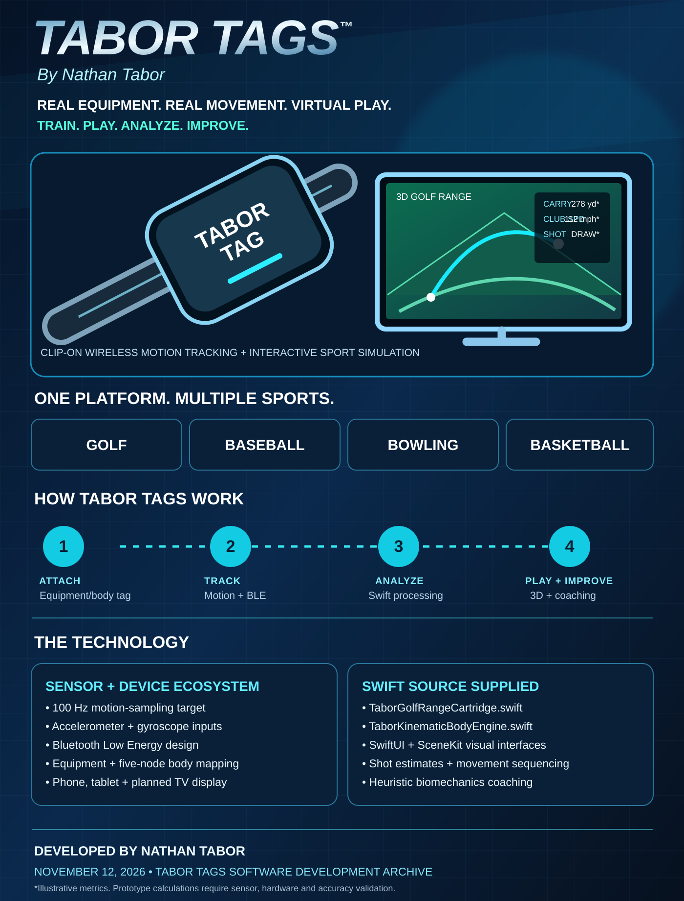

# TABOR TAGS
### By Nathan Tabor · November 12, 2026

**Real equipment. Real movement. Virtual play. Performance feedback.**

Tabor Tags is Nathan Tabor's multi-sport wireless motion-tracking and interactive-simulation development project. The supplied material contains **actual Swift source code** for a golf simulation engine, a 3D golf range interface, a multi-node athlete biomechanics engine, and SwiftUI coaching displays. This directory preserves the original submission, includes extracted source modules, and documents the remaining integration and validation work.

## Product system

**Attach → Track → Analyze → Play & Improve**

- **Equipment tag:** A planned snap-on inertial sensor for a golf club, baseball bat, compatible bowling equipment, and other suitable sport accessories. Application to sports balls requires separate safety, mass/balance, attachment, and radio testing.
- **Athlete tag set:** Planned wearable devices mapped to pelvis/belt, torso/chest, lead wrist, lead knee/leg, and equipment.
- **Wireless link:** Bluetooth Low Energy (BLE) proposed to relay accelerometer/gyroscope and timestamp data to a companion mobile app.
- **Personal simulator:** A phone or tablet runs the sport-specific simulation and metrics. Television/AirPlay/HDMI presentation is a proposed integration path.
- **Coaching:** Multiple time-aligned sensor streams are intended to support motion-sequence feedback across golf, baseball, basketball, and bowling.

## Software that was supplied

| Source file | Present functionality |
| --- | --- |
| [`TaborGolfRangeCartridge.swift`](Sources/TaborGolfRangeCartridge.swift) | Seven club presets; selected-club parameters; swing-vector processing; **estimated** club/ball speed, dynamic loft, spin, carry, roll-out, dispersion, and shot shape; session shot history; SwiftUI/SceneKit driving-range tracer |
| [`TaborKinematicBodyEngine.swift`](Sources/TaborKinematicBodyEngine.swift) | BLE peripheral UUID to body/equipment role mapping; motion-sample ingestion; 450 ms motion windows; chronological peak-velocity sequencing; heuristic efficiency score; bottleneck and coaching messages; athlete UI |
| [`original-submission.txt`](docs/original-submission.txt) | Complete supplied project text, user-authored wording and technical modules in their original context |

The extracted Swift modules remove incidental transcript text ("Use code with caution.") and make two string-interpolation repairs in the biomechanics display. The **original supplied material is preserved** separately, without those repairs.

## Planned 5-node configuration

1. Pelvis/belt
2. Torso/lead shoulder
3. Lead wrist/forearm
4. Lead knee/leg
5. Club/bat/compatible equipment

The specification calls for **100 Hz sampling** and proposes multi-tag BLE clock synchronization. These are **targets**, not demonstrated timing or accuracy measurements.

## Golf feature set in the code

The existing golf engine provides Driver, 3-Wood, 5-Iron, 7-Iron, Pitching Wedge, Sand Wedge, and Putter presets. It processes a `UnifiedThrowVector` and renders a simple ball tracer in SceneKit. Putting has separate distance behavior.

**Measurement distinction:** Ball speed, ball spin, carry distance, attack angle, and other outputs are calculated from model inputs and assumptions; the supplied code does not establish physical measurement accuracy comparable to a certified launch monitor. The current solver is a prototype approximation, not a validated aerodynamic model.

## Integration dependencies

The Swift sources reference project-side components that are **not included in this Tabor Tags submission**:

- `TactileBLEPropManager`
- `UnifiedThrowVector`
- The broader `TactileCoreSDK.swift` integration mentioned in the supplied specification
- BLE peripheral firmware, hardware design, calibration protocol, and timestamp synchronization implementation

To run this in Xcode, first provide compatible definitions/implementations of those dependencies, connect an appropriate BLE data stream (or a clearly labeled simulated input), and add these source files to an iOS SwiftUI target with SceneKit support. Further work is required for multi-tag connection management, calibrated biomechanics, real TV presentation, and individual sport cartridges.

## Where the project stands

- **Present:** Original development specification; extracted Swift modules; code-level simulator/athlete interfaces; product and hardware architecture.
- **Not verified here:** Hardware prototypes, firmware, BLE bench testing, synchronized five-tag operation, a successfully built complete iOS app, measurement fidelity, or a released commercial product.
- **Not supplied:** Complete baseball, basketball, and bowling simulation implementations. They are designed extensions of the platform.

See [Technical status](docs/TECHNICAL-STATUS.md) for precise gaps and acceptance tests.

## Marketing

- [Product flyer — GitHub-renderable SVG](marketing/Tabor-Tags-Flyer.svg)
- [Marketing copy and feature inventory](marketing/PRODUCT-MARKETING.md)

### Attribution
**Tabor Tags — By Nathan Tabor.** This directory records code and product materials supplied November 12, 2026. Any intellectual-property or patent status must be verified independently. The repository is public and carries a repository-level Apache 2.0 license; review licensing and disclosure implications before distributing sensitive invention details.
