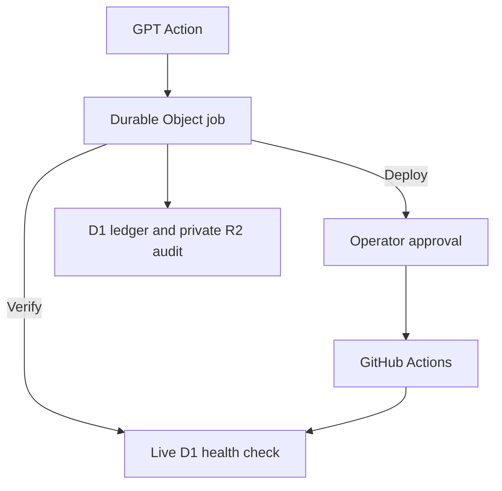

# The Conductor

Nathan AI’s control plane for submitting a known operation, seeing it move through its stages, and verifying what actually ran. The first registered project is Zeros and Ones.

[Open the Conductor cockpit](https://unified-operations-cockpit.nathantaboract.workers.dev/tabor-sites/conductor) · [Public readiness](https://unified-operations-cockpit.nathantaboract.workers.dev/tabor-sites/conductor/api/health) · [Custom GPT Actions schema](openapi.yaml)

[Tabor Song & KJV Index](song-bible-index/) catalogs recordings and source-backed Bible comparisons. [Live catalog](https://tabor-music-lab.nathantaboract.workers.dev/song-bible-index/) · [Handoff receipt](https://tabor-music-lab.nathantaboract.workers.dev/song-bible-index/api/handoff)

[Sovereign Minds handoff](https://unified-operations-cockpit.nathantaboract.workers.dev/tabor-sites/conductor/handoffs/sovereign-minds) records the registry release, the independent Zero and One Workers, reviewed Lasso evidence, and related deployments in the Conductor ledger. [Versioned receipt](sovereign-minds/receipt.json)

[Cryptocurrency Mining handoff](https://unified-operations-cockpit.nathantaboract.workers.dev/tabor-sites/conductor/handoffs/cryptocurrency-mining) records Rocket’s fleet snapshot, the Bitcoin proof, independent mining projects, and the twelve Academy modules. [Versioned receipt](cryptocurrency-mining/receipt.json)

[Tabor Academy course handoff](https://unified-operations-cockpit.nathantaboract.workers.dev/tabor-sites/conductor/handoffs/tabor-academy-architecture-course) records the eight How to Operate in This World modules, their two teaching tracks, the learner worksheet, and the verified Academy release. [Versioned receipt](academy/architecture-course-receipt.json)

[Sovereign MINDs](sovereign-minds/) uses the same Cloudflare cockpit and provides a GitHub release verifier, a source ledger, and the Lasso of Truth prompts.

[Fixed-Anchor Binary Encoding](fixed-anchor/) preserves the submitted packet and implements the 144-bit acceptance gate. [Live handoff and downloads](https://unified-operations-cockpit.nathantaboract.workers.dev/tabor-sites/conductor/handoffs/fixed-anchor-binary) · [D1 handoff receipt](https://unified-operations-cockpit.nathantaboract.workers.dev/tabor-sites/conductor/api/handoffs/fixed-anchor-binary)

[Nathan AI Node Template](node-template/) connects the existing AI, Worker and compute registries to the Conductor's shared receipt API and audit ledger. [Live contract](https://unified-operations-cockpit.nathantaboract.workers.dev/tabor-sites/conductor/api/node-template/contract) · [Conductor handoff](https://unified-operations-cockpit.nathantaboract.workers.dev/tabor-sites/conductor/handoffs/nathan-ai-node-template)

[Lasso of Truth Release Gate](release-gate/) validates staged binary, algorithm and LLM output before release and returns a 1 or 0 with a receipt.

[Groundskeeper AI](groundskeeper/) runs Collyn Phillips Tabor’s infrastructure and continuity role through read-only service checks and the Lasso release gate.

| Command | Operation | Completion evidence |
| --- | --- | --- |
| `verify` | Read the registered Zeros and Ones health endpoint, with bounded retries | Healthy response and a 40-character deployed commit SHA |
| `deploy` | Require the operator’s approval, then dispatch `deploy.yml` on `main` | Successful GitHub run and a healthy endpoint reporting that run’s commit SHA |



## One-time credentials

Set these as encrypted secrets on `nathan-ai-conductor` in the `nathan-tabor-platforms` namespace. Use a separate strong random value for each key. Keep the operator key in the operator’s credential store.

| Worker secret | Purpose |
| --- | --- |
| `DISPATCH_KEY` | Custom GPT authenticates with this value as API Key → Bearer. It can submit and read jobs for the registered project. |
| `OPERATOR_KEY` | Human enters this value in the cockpit to approve, reject, pause or resume. |
| `GITHUB_ACTIONS_TOKEN` | Fine-grained token limited to this GitHub repository with Actions write permission. |
| `GITHUB_WEBHOOK_SECRET` | Optional shared secret for an incoming GitHub webhook subscribed to workflow runs. |

Import [openapi.yaml](openapi.yaml) in the Custom GPT’s Actions editor. Map a check of Zeros and Ones to `verify` and a deployment request to `deploy`. Report `done` only when the job returns `done`. Return the job ID immediately for `awaiting_approval`. The dispatch key cannot approve its own deployment request. Both keys share visibility into the registered project’s job history.

The Zeros and Ones workflow uses its own encrypted GitHub Actions secrets, `CLOUDFLARE_API_TOKEN` and `CLOUDFLARE_ACCOUNT_ID`. The Conductor holds its GitHub Actions credential separately. The deployment uses the checked-in workflow on `main`.

The optional webhook URL is `/tabor-sites/conductor/api/webhooks/github` on the cockpit origin. The Conductor verifies the raw payload with HMAC-SHA256 and checks the repository. A valid completion event can wake a tracked job. The authenticated GitHub API and the live endpoint supply the release evidence.

## State and retries

A SQLite Durable Object serializes execution per registered project. The UUID deduplicates submissions, and the queue is bounded. Pause stops new jobs from starting and leaves an already-dispatched GitHub run in progress. Three consecutive failed jobs open the circuit. An uncertain dispatch or expired GitHub wait pauses the queue immediately. The operator can resume it. If GitHub may have received a dispatch without returning a receipt, the job enters `needs_review`. Check GitHub before placing another deployment request.

A persistent audit outbox mirrors job transitions to D1 and private R2. R2’s `events/` prefix carries a seven-day retention lock. The cockpit displays the job ID, state, GitHub run link, live release, and any failure reason. The Worker emits structured transition logs. The cockpit API uses bearer authentication. Durable Object alarms advance jobs. Cloudflare Access, external Logpush, AI Gateway budgets, Vectorize, and Cloudflare Queues or Workflows are independent integrations.

## Release

From this directory, with Wrangler installed, apply the dedicated D1 migration before deployment.

```sh
wrangler d1 migrations apply nathan-ai-conductor-ledger --remote
wrangler deploy --dispatch-namespace nathan-tabor-platforms --var "RELEASE_SHA:$(git rev-parse HEAD)"
```

The public route uses the existing site registry at `app-factory/tabor-website-builder/src/sites.mjs`.

## TIME for the seven private Zone sandboxes

[Read TIME status](https://unified-operations-cockpit.nathantaboract.workers.dev/tabor-sites/conductor/api/time) for the most recent alarm receipt and next tick. The alarm checks the project identity in each staging D1 database every 15 minutes across UTC boundaries. A failed database check leaves the next tick scheduled. Access to the project databases is through fixed Worker bindings, and the alarm issues SELECT statements only. The public status returns timestamps and counts.

[Zone Sandbox reconciliation](zone-sandbox/README.md) verifies the resource inventory. The clock and automated provisioning are independently observable. Starting an idle clock requires a Conductor operator key or a temporary encrypted bootstrap key. Omit the bootstrap key after activation.
