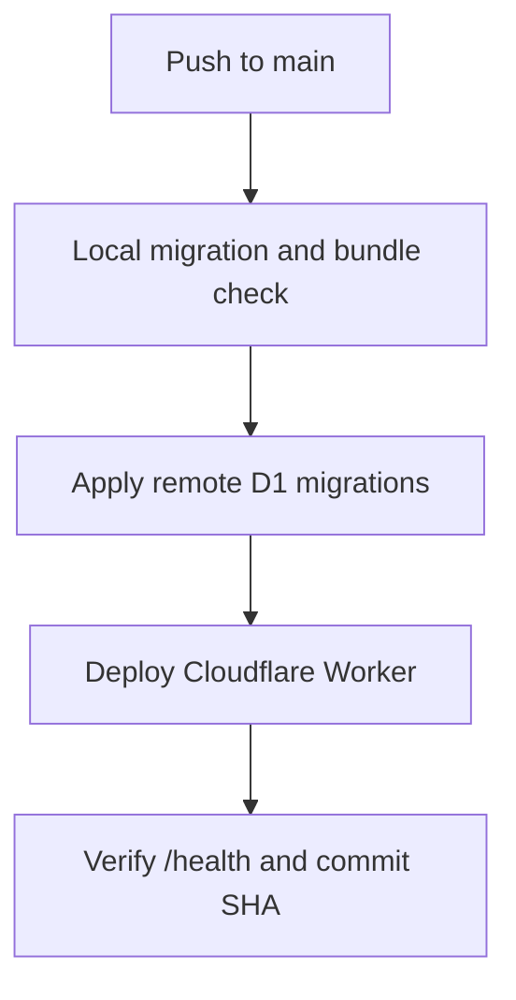
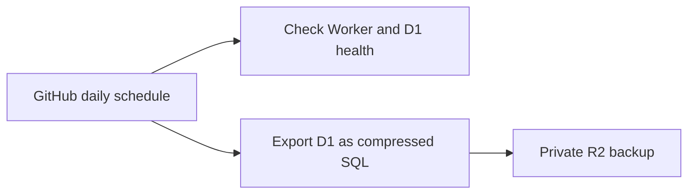
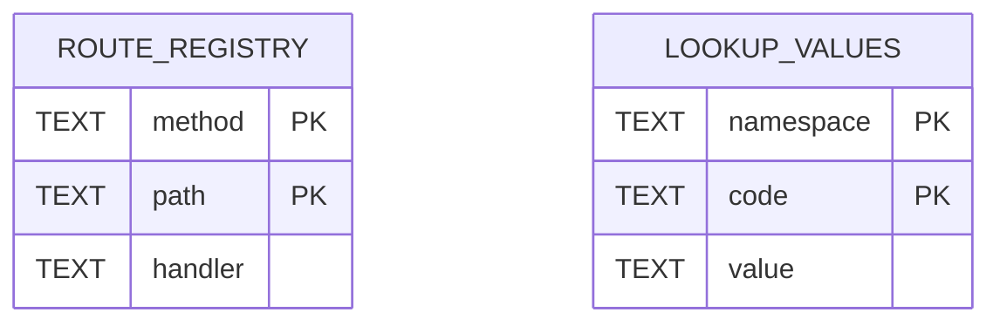

# Zeros and Ones

**1 − 1 = 0** · Clear ambiguity, broken paths, and missing tables.  
**1 + 1 = 2** · Apply the D1 schema, deploy the Worker, and verify the running commit.

This project lives in one repository. Wrangler resolves the Worker and migrations inside this directory. The workflow uses its own working directory because Sovereign Core already has a root Wrangler configuration for `unified-operations-cockpit`.






## Cloudflare deployment

[Open Zeros and Ones](https://unified-operations-cockpit.nathantaboract.workers.dev/tabor-sites/zeros-and-ones) · [Live health and release SHA](https://unified-operations-cockpit.nathantaboract.workers.dev/tabor-sites/zeros-and-ones/health)

The Worker is `nathan-ai-zeros-and-ones` in the existing `nathan-tabor-platforms` dispatch namespace. The Unified Operations Cockpit routes the registered site slug to it. The app has a dedicated D1 database bound as `DB` and a dedicated private R2 backup bucket. The D1 identifier is present in `wrangler.toml`. Local commands use Wrangler's local database.

| GitHub Actions secret | Value |
| --- | --- |
| `CLOUDFLARE_API_TOKEN` | Account-scoped token with Workers Scripts Write, D1 Write, and Workers R2 Storage Write |
| `CLOUDFLARE_ACCOUNT_ID` | Cloudflare account ID |

The two encrypted credentials live under **Settings → Secrets and variables → Actions**. On pushes to `main`, the workflow checks local migrations and the Worker bundle before applying the remote migration and deploying. Superseded commits finish the local check. The workflow can also be run manually from `main`.

The schedule runs daily at **03:17 UTC**. It checks the live Worker and attempts an R2 export even if health fails. Backup keys follow `d1/<database>/<UTC-date>/<run-id>-<attempt>.sql.gz`. The Actions summary records the object key. The SQL dump goes to the private bucket `nathan-ai-zeros-and-ones-backups`.

## D1 schema



<details>
<summary>SQL migration</summary>

```sql
CREATE TABLE IF NOT EXISTS route_registry (
    method TEXT NOT NULL,
    path TEXT NOT NULL CHECK (substr(path, 1, 1) = '/'),
    handler TEXT NOT NULL,
    PRIMARY KEY (method, path)
);

CREATE TABLE IF NOT EXISTS lookup_values (
    namespace TEXT NOT NULL,
    code TEXT NOT NULL,
    value TEXT NOT NULL,
    PRIMARY KEY (namespace, code)
);

CREATE INDEX IF NOT EXISTS route_registry_handler_idx
    ON route_registry (handler);

INSERT INTO route_registry (method, path, handler)
VALUES ('GET', '/health', 'health')
ON CONFLICT (method, path) DO NOTHING;

INSERT INTO lookup_values (namespace, code, value)
VALUES ('system', 'schema_version', '1')
ON CONFLICT (namespace, code) DO NOTHING;
```

Versioned source is [0001_foundation.sql](migrations/0001_foundation.sql). Add a new numbered migration for later schema changes. Keep changes compatible with the previous Worker version while D1 migrates and before the new code takes traffic.

</details>

<details>
<summary>Wrangler configuration and deployment workflow</summary>

```toml
name = "nathan-ai-zeros-and-ones"
main = "src/index.js"
compatibility_date = "2026-11-19"
workers_dev = false

[[d1_databases]]
binding = "DB"
database_name = "nathan-ai-zeros-and-ones"
database_id = "b2fe07ab-0fb1-4aad-8cd1-e1a7ba0ddc7a"
migrations_dir = "migrations"
```

[Wrangler configuration](wrangler.toml) · [GitHub Actions workflow](../../.github/workflows/deploy.yml)

</details>

<details>
<summary>Endpoint and verification contract</summary>

| Request | Result |
| --- | --- |
| `GET /health` | HTTP 200 with `status: "ok"` and the release SHA after D1 reads confirm both seed records |
| `GET /health` with D1 unavailable | HTTP 503 with `status: "unavailable"` |
| `HEAD /health` | Health status with an empty body |
| Other methods at `/health` | HTTP 405 |
| `GET /` | Project home and verification links |
| Other paths | HTTP 404 |

A local Worker reports `"release": "local"`. On a push, the workflow requires the live response to match the GitHub commit SHA. See the [JSON response schema](docs/health.schema.json).

</details>

## GitHub file previews and commit evidence

| File | Native GitHub view |
| --- | --- |
| [routes.csv](data/routes.csv) | Searchable routes table |
| [lookups.tsv](data/lookups.tsv) | Searchable seed lookup table |
| [sample-grid.geojson](data/sample-grid.geojson) | Interactive map with a synthetic grid cell |
| [health.schema.json](docs/health.schema.json) | Standalone JSON schema suitable for a Gist |

The CSV and TSV mirror the SQL seed data for browsing. Publish the JSON schema as its own GitHub Gist when a separate distribution URL is needed. Open the Gist's revision history and use **Raw** on the chosen revision to copy a URL pinned to that version. A raw Gist can be fetched over HTTPS with `curl --fail --location "<pinned raw URL>"`. The pipeline gets its runtime and migrations from the checked-out repository.

After committing, open a GitHub file, press **Y** to pin the URL to the commit, and Shift-click the last line to include a range such as `#L10-L25`. On a pull request or commit diff, add `?w=1` to hide whitespace-only changes. If the URL already has a query string, append `&w=1`.

## Local verification

Run in `deployments/zeros-and-ones` with Node.js 24.

```sh
npm ci
npx --no-install wrangler d1 migrations apply nathan-ai-zeros-and-ones --local
npx --no-install wrangler deploy --dispatch-namespace nathan-tabor-platforms --dry-run
npx --no-install wrangler dev
```

In another shell, check `curl --fail http://localhost:8787/health`. The expected response is `{"status":"ok","release":"local"}`.

GitHub and Cloudflare references. [Workflow syntax](https://docs.github.com/en/actions/reference/workflows-and-actions/workflow-syntax) · [D1 migrations](https://developers.cloudflare.com/d1/reference/migrations/) · [D1 export](https://developers.cloudflare.com/d1/wrangler-commands/#d1-export) · [R2 upload](https://developers.cloudflare.com/r2/reference/wrangler-commands/#r2-object-put)
