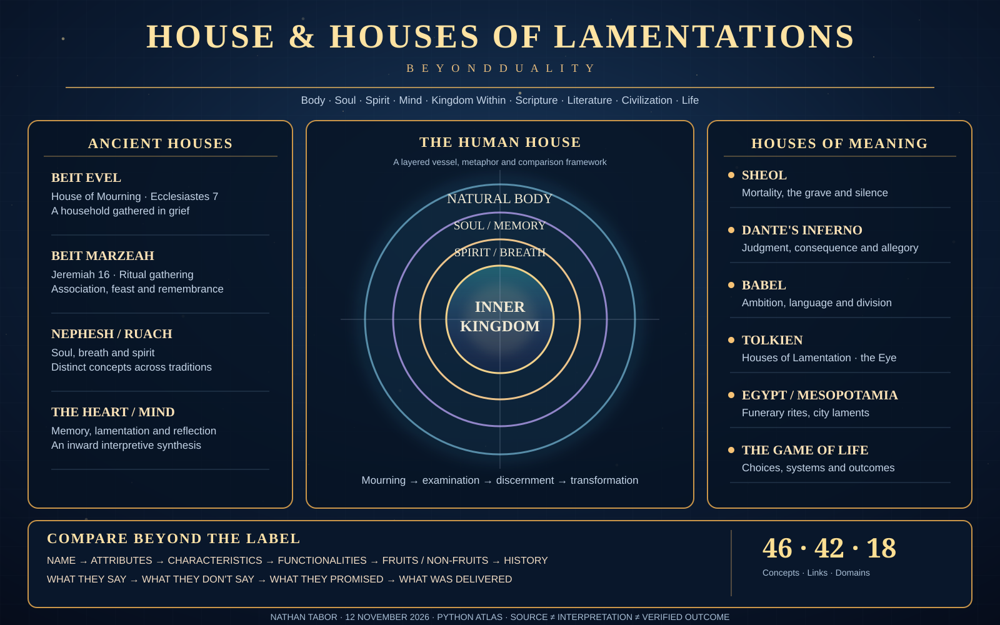

# HOUSE / HOUSES OF LAMENTATIONS — BEYOND DUALITY

**Python atlas and comparison engine** based on the 2026-11-12 source conversation, compiled by request of **Nathan Tabor**.

> Source-preservation rule: `source_transcript.txt` contains the complete pasted discussion in its original order. That conversation includes earlier assistant statements as well as the user's words; the entire transcript is **not** claimed as user-authored text.



## The mapping

**HOUSE / HOUSES OF LAMENTATIONS → Natural Body → Soul → Spirit → Heart / Mind → Kingdom Within → Tolkien's Houses → Sheol / Dante's Inferno / Babel / Game of Life → BEYOND DUALITY.**

This model relates texts, language, human experience, literature, institutions, software and user-authored frameworks without assuming that an interpretive link is automatically historical proof or scientific fact.

## Contents

| File | Purpose |
|---|---|
| [`lamentations_atlas.py`](lamentations_atlas.py) | Executable atlas, trace, search, comparisons, audit framework and export |
| [`source_transcript.txt`](source_transcript.txt) | Complete original pasted conversation |
| [`out/comparison_matrix.csv`](out/comparison_matrix.csv) | 46 concepts compared across the evaluation columns |
| [`out/atlas_report.md`](out/atlas_report.md) | Human-readable atlas with concepts and links |
| [`out/sample_case.json`](out/sample_case.json) | Case audit input for comparing claims to results |
| [`test_atlas.py`](test_atlas.py) | Eight unit tests, standard library |
| [`artwork/atlas-poster.svg`](artwork/atlas-poster.svg) | Scalable, text-first poster accompanying the original generated artwork |
| [`artwork/ARTWORK.md`](artwork/ARTWORK.md) | Poster provenance, exact original image SHA-256, and status |

`out/atlas.json` and other export outputs are reproducibly generated with the `export` command. The original 2026-11-12 downloadable ZIP also includes a compiled JSON copy.

## Run with Python 3.10+

No third-party packages are needed. In this directory:

```bash
python lamentations_atlas.py validate
python lamentations_atlas.py overview
python lamentations_atlas.py original-words
python lamentations_atlas.py show inner_house
python lamentations_atlas.py trace inner_house --depth 2
python lamentations_atlas.py compare house_of_mourning houses_of_lamentation_tolkien
python lamentations_atlas.py compare sheol game_of_life
python lamentations_atlas.py search "kingdom"
python lamentations_atlas.py matrix
python lamentations_atlas.py export --out out
python lamentations_atlas.py evaluate out/sample_case.json
python -m unittest test_atlas.py
```

## The comparison method

**NAME → ATTRIBUTES → CHARACTERISTICS → FUNCTIONALITIES → FRUITS → NON-FRUITS → HISTORY → WHAT THEY SAY → WHAT THEY DON'T SAY → WHAT THEY PROMISED → WHAT WAS DELIVERED**

1. Record attributes and distinguishing characteristics.
2. Establish what a person, place, text, institution, or system actually does.
3. Distinguish beneficial fruits and harmful non-fruits using evidence.
4. Preserve dated history with attribution.
5. Compare statements, omissions and documented promises to actual delivery.
6. Report conflicts and unknowns; **unknown is not a negative result**.
7. Trace analogies across 18 application domains without silently treating them as identical.

The atlas currently contains **46 concepts, 42 relationships and 18 application domains**.

## Evidence discipline

- Biblical text, historical/linguistic claims, fictional literature, earlier assistant interpretations, and Nathan Tabor's own statements are separately labeled.
- The KJV's wording in Luke 17:21 is preserved; a translation dispute is recorded rather than concealed.
- A claim that the "house of lamentations" is inside the mind is preserved as the user's synthesis; it is not substituted for an explicit historical usage of that phrase.
- Tolkien's "Houses of Lamentation" and the Halls of Mandos are treated as distinct literary concepts; their inversion is an interpretation.
- The computational framework models comparisons and classifications; it does not assert all traditions are provably identical.
- Crosslinks to Nathan AI, the Seven Houses, ANTIOCH MEMORY, the Streaming-Consciousness Atlas and BUILD / CLEAR are labeled prior-project context.
- No private passwords, keys, credentials or private case records belong here.

## Extending

Add `Concept` records with `add(...)`, links with `connect(...)`, and reference details to `SOURCE_REFERENCES`. Use `audit_template(...)` to compare outcomes in institutions, products, texts, games and creative worlds. Keep original language in the transcript, and always distinguish source evidence from later interpretations.

**Artwork note:** The large rendered PNG shown in ChatGPT was generated separately and is recorded by its cryptographic hash in `artwork/ARTWORK.md`. The SVG in this repository is a distinct, repository-native presentation of the atlas, not a byte-identical copy of that PNG.
