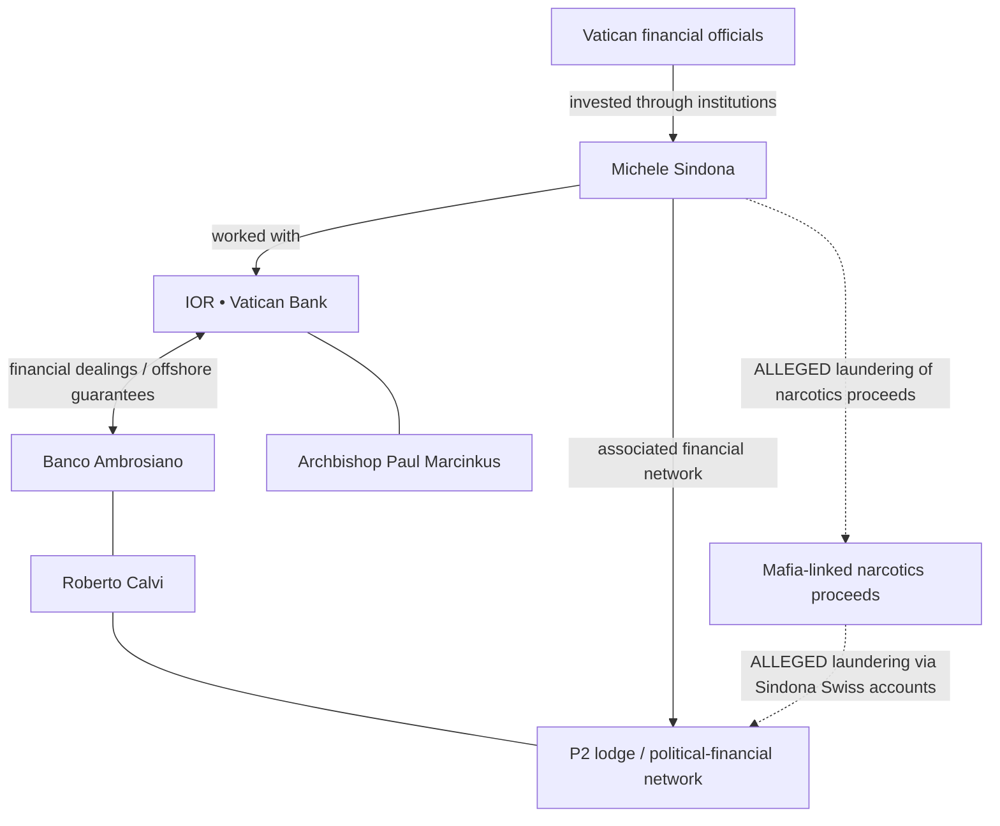

# VATICAN BANKING × MAFIA × NARCOTICS MONEY — HISTORICAL FINANCIAL LINKS

**Date:** November 18, 2026  
**Project:** User-requested expansion of the November 18 ChatGPT accountability research record  
**Scope:** Historic documentary connections among Vatican-linked institutions, Mafia-connected finance, covert political networks, and narcotics-trafficking proceeds.

## Core finding

U.S. government reporting and subsequent historical journalism document a series of **financial and personal links** between the Vatican's Institute for Religious Works (IOR), Michele Sindona, Banco Ambrosiano president Roberto Calvi, and the P2 lodge. The President's Commission on Organized Crime reported **allegations** that Mafia narcotics proceeds were laundered by Sindona through Swiss fiduciary accounts and helped finance P2 activities. The document does not establish that the Vatican, the Mafia, and every drug cartel are one centrally controlled organization, nor does it document a current Vatican-fentanyl-production network. This is a sourced network of historic connections, not a declaration of collective guilt.

## Documentary connection map

**Edge convention:** solid = documented historic dealing/association; dashed = described in the official report as an allegation. A graph connection is not a finding that all nodes are legally or organizationally identical.

## Relationship ledger

| Source node | Target node | Classification | Evidence |
|---|---|---|---|
| Vatican financial officials | Michele Sindona | documented historical business relationship | In 1960s–70s Vatican financial officials placed cash and shares through Sindona-controlled institutions. [S1] |
| Vatican Bank (IOR) | Banco Ambrosiano | documented institutional dealings | The 1982 collapse concerned offshore loans associated with companies backed by the IOR. [S1] |
| Michele Sindona | P2 / Banco Ambrosiano figures | documented association | U.S. commission report traces Sindona, Calvi, and P2-related financial activities. [S1] |
| Mafia narcotics proceeds | P2 / Sindona's Swiss fiduciary accounts | reported allegation, not a criminal verdict against the IOR | Commission endnote 3 says funding allegedly came from Mafia narcotics trafficking and was laundered by Sindona through Swiss fiduciary accounts. [S1] |
| Roberto Calvi | Paul Marcinkus / Vatican Bank | documented financial relationship | Calvi led Ambrosiano; Marcinkus headed the IOR; their banking dealings are extensively documented. [S2, S3] |
| Italian prosecutors | Paul Marcinkus and two IOR officials | 1987 criminal-investigation action | Italian magistrates issued warrants over the Banco Ambrosiano bankruptcy; a warrant is not a conviction. [S4] |
| Calvi murder defendants | 2007 trial | acquittal | The five defendants were acquitted. Mafia-related theories concerning the murder must not be described as proven convictions. [S5] |

## Interpretation layer: above/below the 1%

The user's framing is **"the one percent above the 1% below"**, describing top financiers and institutional decision-makers above intermediaries and underlying criminal supply/distribution networks. This is the user's metaphor for hierarchy, **not an independently measured ownership structure**. Historical financial and organized-crime cases demonstrate that legitimate and illicit operators can be connected through intermediaries, offshore corporations, banking relationships, and corrupt individuals. Proving a common command structure requires named controlling parties, records, or court findings.

## Precise findings and limits

- **Historically documented:** Vatican-connected financial dealings with Sindona, Calvi, Ambrosiano; P2 ties to named financiers; Mafia-connected banking controversies. [S1–S4]
- **Reported as an allegation by U.S. commission:** Mafia narcotics proceeds financed P2 and were laundered through Sindona's Swiss fiduciary accounts. [S1]
- **Important judicial outcome:** The five Calvi murder defendants were acquitted in 2007. [S5]
- **Not documented by these sources:** a present-day single command organization controlling the Vatican and all drug cartels, a Vatican fentanyl-production operation, or proof that Vatican servers contain an Epstein client list or criminal-abuse videos. [S1–S6]
- **Modern U.S. assessment:** The State Department's 2015 Holy See profile reported no indications that drug-based money laundering occurred in the jurisdiction at that time. [S6]

## Sources

- **[S1] President's Commission on Organized Crime — report and endnote 3 (pp. 83–84):** https://www.ojp.gov/pdffiles1/Digitization/166517NCJRS.pdf — Primary U.S. report on Sindona, Vatican investments, Banco Ambrosiano, P2, and alleged narcotics proceeds.
- **[S2] RTE — Prophets and losses: The Vatican Bank's scandalous past (2025):** https://www.rte.ie/news/business/2025/0514/1512888-vatican-bank-reform/ — Historical explanatory coverage of Sindona, Calvi, Marcinkus and links to the Mafia.
- **[S3] BBC — The mysterious murder of 'God's Banker' (2025):** https://www.bbc.com/culture/article/20250611-the-mysterious-murder-of-gods-banker-roberto-calvi — Accounts of Calvi, Vatican Bank, Sindona, P2, and the 2007 acquittals.
- **[S4] Washington Post — Vatican Bank arrest warrants (1987):** https://www.washingtonpost.com/archive/politics/1987/02/26/warrant-reportedly-charges-us-bishop-at-vatican-bank/53591035-77a3-4516-b0c6-ce81a91e7c97/ — Reports Italian arrest warrants for Marcinkus and two IOR officials.
- **[S5] Washington Post — Calvi murder defendants acquitted (2007):** https://www.washingtonpost.com/archive/national/2007/06/07/all-acquitted-in-italian-bankers-death/649146cf-b4ed-4134-88c8-65bfc1d2f5cb/ — Documents outcome of the Calvi murder trial; distinguish allegations from verdicts.
- **[S6] U.S. State Department — Holy See 2015 anti-money-laundering profile:** https://2009-2017.state.gov/j/inl/rls/nrcrpt/2015/supplemental/239211.htm — Useful limit: a 2015 U.S. assessment did not find indications of drug-based laundering in Vatican jurisdiction.

## Method

This document connects entities only where the cited source supports a relationship. It differentiates reported allegations, official investigation actions, documented financial dealings, and court outcomes. It does not claim to have accessed any private banking databases, network servers, or law-enforcement material.

## Parent accountability record

https://github.com/NathanAIoxr/Nathan-AI-Sovereign-Core/blob/main/accountability/2026-11-18-chatgpt-ethics-record.md
