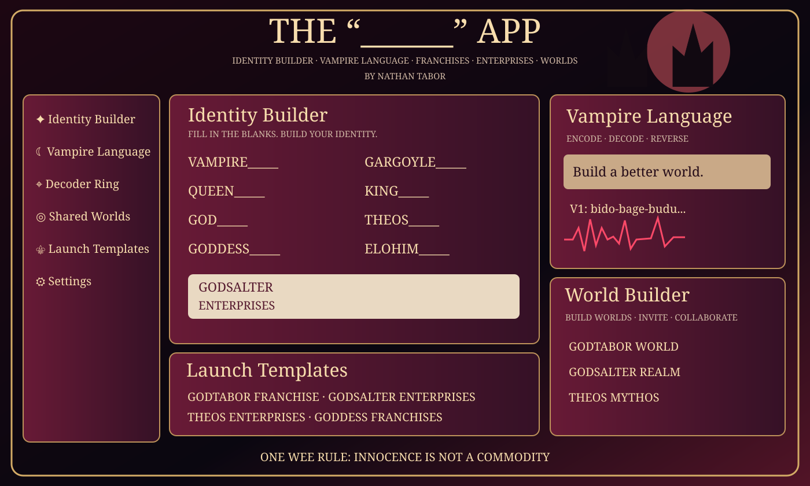

# THE “______” APP — by Nathan Tabor
## Identity Builder · Vampire Language · Franchises · Enterprises · Worlds

This GitHub branch adds the project to **NathanAIoxr/Nathan-AI-Sovereign-Core** as an additive standalone-app directory. The author-supplied wording is preserved separately in `SOURCE_WORDING.md`.



### Open and use
Open `index.html` in a modern browser, or serve this folder as a static website (e.g., GitHub Pages). The app is designed with relative asset URLs. Navigate between Identity Builder, Vampire Translator, Secret Decoder, Restored Lexicon, and Worlds.

### What this browser edition does
- Choose or customize VAMPIRE, GARGOYLE, QUEEN, KING, GRANDMA, POP, GOD, THEOS, ELOHIM, ELOHER, ALLAH, JESUS, GODDESS, SATAN, and many other identity prompts.
- Create personal identities, enterprises and franchise **concepts**; preserve literal, figurative and mythological settings. These do **not** register legal entities, franchise agreements or trademarks.
- Save drafts locally, export JSON, make new vampire messages using a reversible Unicode-capable V1 encoding, and decode ROT-shift ring puzzles.
- Explore a *partial recovered historical word index* without misrepresenting it as a complete ancient vampire language.
- Build browser-local world drafts and posts, which are **not** synchronized with other devices.

### Not yet included in this GitHub static edition
- The full original Node-based server/backend and multiplayer rooms from the two locally generated ZIP packages are not uploaded here.
- Google Cloud/LibreTranslate in-app translation needs an independently configured backend. An external Google Translate link works.
- The original generated PNG mockup is not stored in GitHub; the GitHub repository contains an **editable SVG depiction** in `artwork/app-layout.svg`. Original PNG file in the ChatGPT project: `gothic_identity_builder_dashboard.png`.
- No published app-store listing, live deployment, legal franchise launch, patent or trademark grant is claimed.

### Source-preservation files
- `SOURCE_WORDING.md`: verbatim user-authored headings, names and the quoted innocence rule. The threat to hack others' systems is preserved as quotation, **not implemented**.
- `README-original.md`: original THE ______ prototype documentation.
- `vampire-language-original-README.md`: original vampire prototype documentation.
- `original-interface-reference.html`: the original v0.2 HTML structure, preserved before GitHub-path adaptation.
- `index.html`, `app.js`, `style.css`: interoperable static GitHub edition. It is a partial adaptation, **not a byte-for-byte replacement** for the original full-source ZIP packages.

### Provenance checksums of locally generated source packages
- `THE_BLANK_APP_by_Nathan_Tabor_v0.2.zip`: SHA-256 `e0f244c0273c6543fb758d890fe7ed06cee5c0b01b42f158963e2d8af541c7ca`
- `vampire_language_app_prototype.zip`: SHA-256 `599763b42661fcec51874b34ec606d7517aa11937ecc13af50e72f24f1a3dcdf`
- `gothic_identity_builder_dashboard.png`: SHA-256 `1263c90e3c8ef76635892e352d7a10c6fa0885556a74e042e2475c0819553860`

### Community safety
**ONE WEE RULE — INNOCENCE IS NOT A COMMODITY.** The interface requires acknowledgement for core creative actions. Harmful posts can be hidden locally; this is not a substitute for robust moderation or user authentication. There is no hacking or remote-device shutdown behavior. Code messages are puzzles, *not secure encryption*.

### Local check
```sh
node --check app.js
```

Author attribution: **Nathan Tabor**, November 12, 2026.